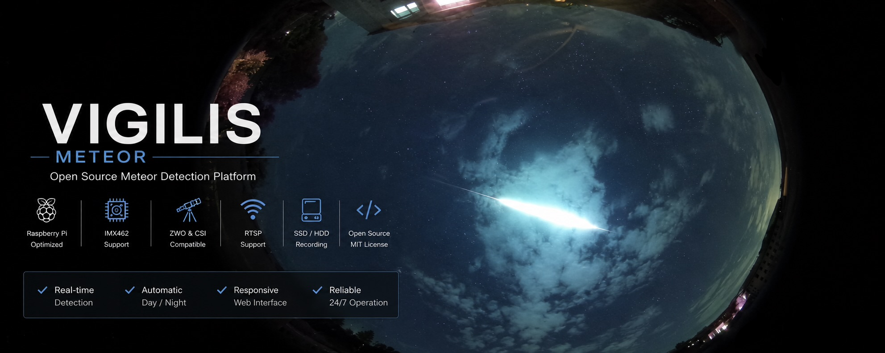
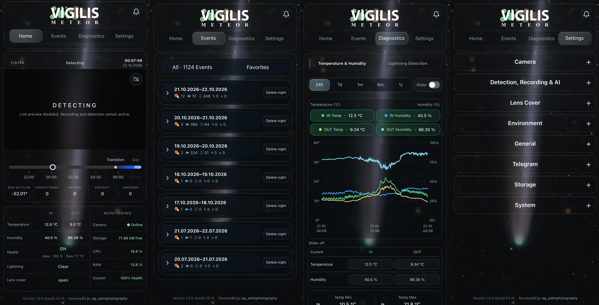
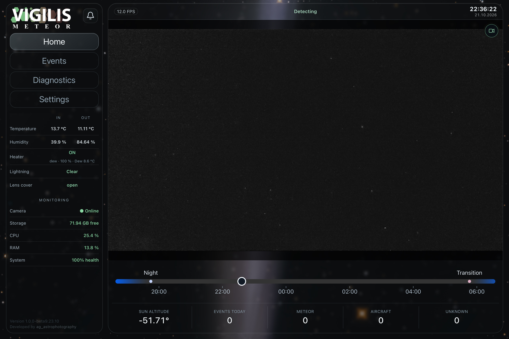
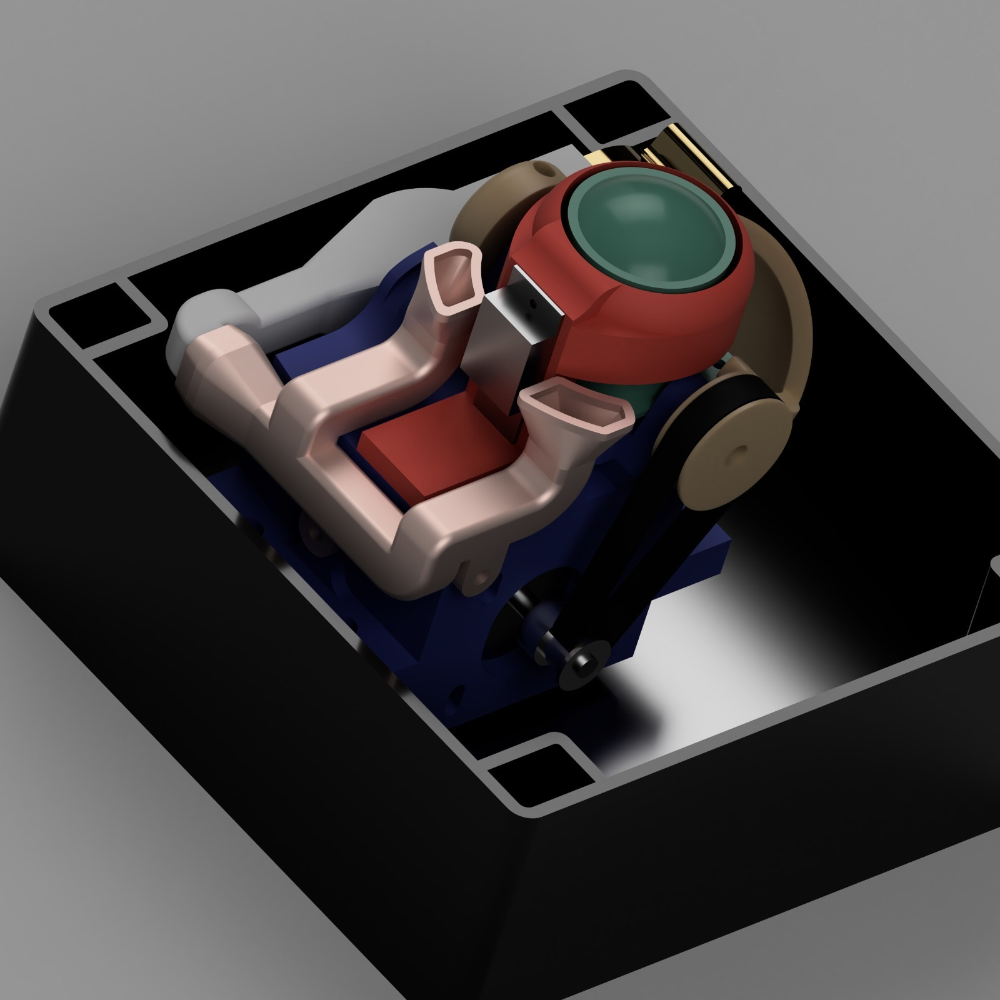
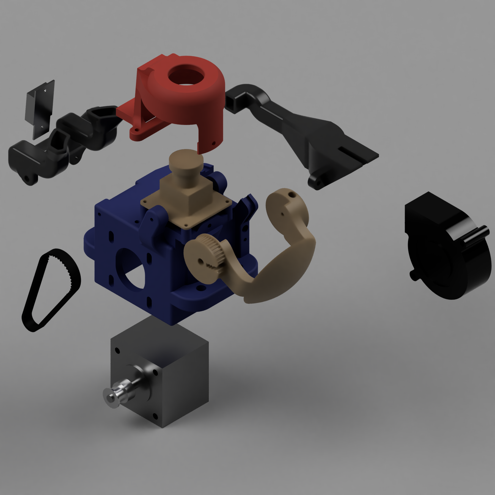

# ☄️ VIGILIS Meteor

**Open-source Raspberry Pi meteor detection and sky-monitoring platform with automated event recording, AI-assisted classification, and a responsive web interface.**

<p align="center">
  
</p>

[](https://github.com/1alex-vag/Vigilis-Meteor/releases)
[](https://www.raspberrypi.com/)
[](https://www.python.org/)
[](LICENSE)

### 📥 Download

**[Download the Latest VIGILIS Meteor Release](https://github.com/1alex-vag/Vigilis-Meteor/releases)**

The release badge above automatically tracks new GitHub releases, including beta versions.

> **Development Status:** Public Beta
>
> VIGILIS Meteor is under active development. Features, hardware compatibility, and system behavior may change between releases.

---

## 🌌 Overview

VIGILIS Meteor is an open-source meteor detection and sky-monitoring platform designed primarily for Raspberry Pi systems.

It combines continuous camera acquisition, motion-based event detection, video recording, AI-assisted classification, and environmental monitoring in a responsive web interface.

The system is designed for autonomous night-sky observation, allowing users to record and review meteor candidates, aircraft, satellites, and other transient sky events.

VIGILIS focuses on efficient resource usage, reliable recording, and flexible hardware integration.

### Designed For

- Meteor observation and recording
- Automated night-sky monitoring
- Transient event detection
- Astronomy and astrophotography projects
- Raspberry Pi-based observing stations
- Continuous unattended operation

---

## ✨ Key Features

### ☄️ Meteor Detection

- Continuous camera-based sky monitoring
- Real-time motion detection
- Automated event recording
- Configurable detection parameters
- Event classification
- Meteor candidate identification
- Aircraft and other object classification
- Event statistics and historical records

### 📷 Camera & Recording

- Raspberry Pi CSI camera support
- Sony IMX462 camera compatibility
- Selected ZWO ASI camera support
- RTSP camera input support
- Configurable camera parameters
- Automatic day and night operation
- Event-based video recording
- Local and external storage support
- Configurable Live Preview resolution

### 🧠 AI-Assisted Classification

- Automated analysis of detected events
- Classification of meteor candidates and other objects
- Integration with the event recording system
- Classification results displayed in the Events interface

AI classification results are estimates and may require visual confirmation.

### 🌙 Astronomical Monitoring

- Astronomical day/night awareness
- Solar altitude information
- Astronomical timeline
- Current monitoring state
- Event counters
- Night-sky observation statistics

### 🔧 Hardware & System

- Raspberry Pi optimized operation
- Environmental monitoring integration
- Optional motorized lens cover
- System health monitoring
- CPU and memory statistics
- Storage monitoring
- Responsive browser-based control
- Integrated software update functionality

---

## 🖥️ Web Interface

VIGILIS Meteor features a modern, responsive web interface designed for desktop computers, tablets, and smartphones.

The interface combines camera monitoring, astronomical information, event management, and hardware controls.

### Dashboard Preview Mobile WebUI



### Dashboard Preview Desktop WebUI




### Home

The Home dashboard provides real-time information about the observing station.

Available information includes:

- Camera preview
- Detector status
- Capture and processing information
- Astronomical timeline
- Solar altitude
- Events today
- Meteor, aircraft, and unknown event counters
- Environmental measurements
- System monitoring
- Hardware status

### Live Preview

The camera preview can be enabled or disabled directly from the Home dashboard.

A compact camera button inside the preview provides direct control without requiring separate activation in Settings.

Supported preview resolution options include:

- 360p
- 480p
- 720p
- 1080p

Live Preview operates independently from the primary camera acquisition, motion detector, and event recording system.

Disabling the preview does not stop meteor detection or recording.

### Events

The Events interface provides access to recorded detections.

Users can review:

- Recorded event videos
- Event classifications
- Detection timestamps
- Event details
- Historical recordings
- Favorite events

### Favorites

Favorite recordings can be accessed through a dedicated gallery.

This provides convenient access to selected events without requiring navigation through individual observing nights.

### Settings

The Settings interface provides configuration options for the installed software and supported hardware.

Depending on the enabled components, settings include:

- Camera and capture parameters
- Detection parameters
- Recording options
- Live Preview resolution
- Storage management
- Environmental monitoring
- Lens cover controls
- System configuration

---

## ☄️ Meteor Detection & Event Recording

The primary purpose of VIGILIS Meteor is the automated detection and recording of transient sky events.

### Detection Process

The system continuously processes incoming camera frames to identify relevant motion.

When an event satisfies the configured detection conditions, VIGILIS can create an event recording and store the associated metadata.

### Event Recording

Recorded events can include video footage of the detected activity.

The recording system is designed to preserve relevant event frames while allowing the camera and detector to continue operating.

### Event Classification

Detected events can be analyzed by the classification system.

Classification categories include:

- Meteor
- Aircraft
- Unknown

Other object types and classification behavior depend on the installed software version and classifier configuration.

Classification should be treated as an automated assessment rather than definitive astronomical identification.

---

## 🧠 AI Classification

VIGILIS Meteor includes AI-assisted event classification.

The classification system helps organize recorded events and distinguish meteor candidates from other moving objects.

### Processing Architecture

VIGILIS separates the main observation workflow into several responsibilities:

1. Camera acquisition
2. Motion detection
3. Event recording
4. Event classification
5. Archive and gallery management

This architecture allows detection and recording to operate independently from browser-based Live Preview.

### Hardware Acceleration

Optional dedicated AI acceleration, such as Google Coral Edge TPU support, is a potential future enhancement.

**Coral USB Accelerator support is not currently documented as an implemented feature.**

Any future integration would require compatible models, runtime support, and validation on Raspberry Pi OS.

---

## 🌙 Astronomical Timeline

The VIGILIS Home dashboard includes an astronomical timeline for monitoring the observing session.

The timeline provides contextual information about the Sun's position and the current phase of the observing period.

Combined with detector status and event statistics, it helps users understand the station's activity throughout the day and night.

---

## 💾 Events, Favorites & Archive

VIGILIS provides event archive management for recorded sky activity.

### Event Archive

The event archive organizes captured recordings and their associated metadata.

Available functions include:

- Event browsing
- Video playback
- Event classification information
- Historical records
- Favorite management
- Archive cleanup

### Favorites Gallery

Selected recordings can be marked as favorites.

Favorites provide quick access to important or interesting events.

### External Storage

Recorded events can be stored on supported storage devices, including external SSDs and HDDs.

### Archive Cleanup

VIGILIS includes tools for removing selected archive records and recordings.

Depending on the selected cleanup operation, users can remove:

- Selected archived events
- Non-favorite recordings
- Favorite recordings
- Records associated with disconnected external storage

Destructive operations require explicit confirmation.

> **Warning:** Archive cleanup may permanently delete recordings or event records. Review the selected operation carefully before confirming deletion.

Disconnected storage cleanup does not require the unavailable drive to be connected.

---

## 🔭 Supported Hardware

### Raspberry Pi

VIGILIS Meteor is primarily developed for:

- Raspberry Pi 4
- Raspberry Pi OS Bookworm
- 64-bit operating system
- Python 3.11

A Raspberry Pi 4 with 4 GB RAM is recommended in the existing project documentation.

Actual system requirements depend on camera configuration, resolution, frame rate, and enabled features.

### Cameras

Documented camera paths include:

- Sony IMX462 CSI camera
- Compatible Raspberry Pi CSI cameras
- Selected ZWO ASI cameras
- RTSP network cameras

The Sony IMX462 is the primary camera used for VIGILIS Meteor development and testing.

Compatibility and available capture features may vary by camera, driver, and operating system.

### Storage

Supported storage configurations include:

- Raspberry Pi system storage
- External USB SSD
- External USB HDD

High-capacity external storage is recommended for installations producing large numbers of event recordings.

---

## 🌡️ Environmental Monitoring

VIGILIS supports optional environmental monitoring and related hardware controls.

Depending on the installed configuration, the station can provide information about:

- Temperature
- Humidity
- Environmental conditions
- Hardware status

Environmental monitoring is optional and depends on the available sensor hardware.

---

## ⚙️ Motorized Lens Cover

VIGILIS Meteor supports an optional motorized lens cover.

The lens cover can provide mechanical protection for the camera's optical system.

Supported functionality depends on the installed motor hardware, position sensors, and application configuration.

The lens cover should be tested and calibrated before unattended operation.

---

## 🔌 Hardware Integration

VIGILIS Meteor is designed to support different camera and hardware configurations.

Typical components may include:

| Component | Purpose |
|---|---|
| Raspberry Pi 4 | Main application controller |
| IMX462 CSI camera | Sky image acquisition |
| External SSD / HDD | Event storage |
| Environmental sensors | Temperature and humidity monitoring |
| Motorized lens cover | Optical protection |
| Network connection | Web interface and update access |

Optional components are not required for basic meteor detection.

Always verify electrical compatibility, power supply requirements, and GPIO assignments before connecting additional hardware.

---

## 🚀 Installation

VIGILIS Meteor is designed for Raspberry Pi OS Bookworm (64-bit).

### Step 1 — Prepare Raspberry Pi

Install Raspberry Pi OS Bookworm (64-bit).

Ensure the operating system is updated and the required camera hardware is connected.

### Step 2 — Download VIGILIS

Download the latest release package:

**[VIGILIS Meteor Releases](https://github.com/1alex-vag/Vigilis-Meteor/releases)**

Alternatively, clone the GitHub repository:

```bash
git clone https://github.com/1alex-vag/Vigilis-Meteor.git
```

### Step 3 — Open the Project Directory

```bash
cd Vigilis-Meteor
```

### Step 4 — Run the Installer

For a repository checkout containing the installation script:

```bash
sudo bash install.sh
```

Follow the installation instructions and prompts provided by the selected release.

### Step 5 — Configure VIGILIS

After installation, open the VIGILIS web interface using the address and port configured by the installer.

Configure the camera, detection parameters, recording storage, and optional hardware.

Once configured, VIGILIS can monitor the sky automatically.

---

## 🔄 Software Updates

VIGILIS includes an integrated software update mechanism.

Available update functionality depends on the installed application version and release package.

The latest publicly available versions can always be found on GitHub:

**[VIGILIS Meteor — Releases](https://github.com/1alex-vag/Vigilis-Meteor/releases)**

The release badge at the top of this README automatically includes beta and stable release versions.

### Beta Releases

VIGILIS Meteor is currently under active beta development.

Beta releases may introduce:

- New functionality
- Performance improvements
- Detector refinements
- Camera compatibility improvements
- User interface updates
- Reliability corrections

Review the release notes before updating an actively operating station.

---

## 📱 Mobile & Remote Access

The VIGILIS web interface is designed for modern desktop and mobile browsers.

Supported device categories include:

- Desktop computers
- iPhone
- iPad
- Android smartphones
- Tablets

The interface provides access to event recordings, camera status, detector information, and station configuration.

For access outside the local network, use a suitably secured remote connection such as a VPN.

Avoid exposing administrative controls directly to the public internet.

---

## 🛠️ System Monitoring & Reliability

VIGILIS provides system monitoring information to help maintain unattended operation.

Monitoring may include:

- Camera state
- Detector status
- CPU utilization
- Memory utilization
- Storage availability
- Hardware status
- Event activity
- Application health

System behavior depends on the installed hardware, software version, and configuration.

For reliable operation, ensure the Raspberry Pi has sufficient cooling, storage capacity, and power supply headroom.

---

## 🏠 VIGILIS Meteor Enclosure

VIGILIS Meteor includes a custom enclosure concept designed for an outdoor camera installation.

The enclosure design can accommodate the camera system and optional supporting hardware.

### Enclosure Design



### 3D Render



Available 3D-printable parts and enclosure resources can be found in the repository where provided.

Before outdoor installation, verify sealing, temperature management, condensation protection, and cable entry points.

---

## 🧪 Development Status

VIGILIS Meteor is actively developed and tested on Raspberry Pi hardware.

The primary development objectives include:

- Reliable continuous camera acquisition
- Accurate motion detection
- Stable event recording
- Efficient resource utilization
- Improved AI-assisted classification
- Reliable hardware automation
- Responsive browser-based monitoring

The project is currently distributed through beta releases.

Real-world testing and user feedback are valuable for improving stability and detection performance.

---

## 🤝 Open Source & Contributions

VIGILIS Meteor is an open-source project.

Contributions, bug reports, testing results, and hardware feedback are welcome.

If you encounter a problem, please include:

- VIGILIS version
- Raspberry Pi model
- Operating system
- Camera model
- Relevant configuration
- Error messages or diagnostic logs
- Steps to reproduce the issue

**[Report an Issue](https://github.com/1alex-vag/Vigilis-Meteor/issues)**

### Feature Requests

Suggestions for future enhancements are welcome.

Please use GitHub Issues to discuss new features, camera integrations, performance improvements, and optional hardware acceleration.

---

## 🌌 VIGILIS Project Family

VIGILIS is an open-source astronomy and sky-monitoring project family.

### ☄️ VIGILIS Meteor

Automated meteor detection, event recording, and AI-assisted classification.

### 🌠 VIGILIS AllSky

Automated AllSky imaging, environmental monitoring, and advanced night-sky processing.

**[Explore VIGILIS AllSky](https://github.com/1alex-vag/Vigilis-Allsky)**

---

## 👨‍💻 Credits

Developed by **Alexander Gschöpf**

Astronomy & Astrophotography:

**[@ag_astrophotography](https://www.instagram.com/ag_astrophotography/)**

---

## 📄 License

VIGILIS Meteor is distributed under the MIT License.

See the [LICENSE](LICENSE) file for details.

---

<p align="center">
  <strong>VIGILIS Meteor</strong><br>
  Automated Meteor Detection & Sky Monitoring<br><br>
  Developed by
  <a href="https://www.instagram.com/ag_astrophotography/">ag_astrophotography</a>
</p>
