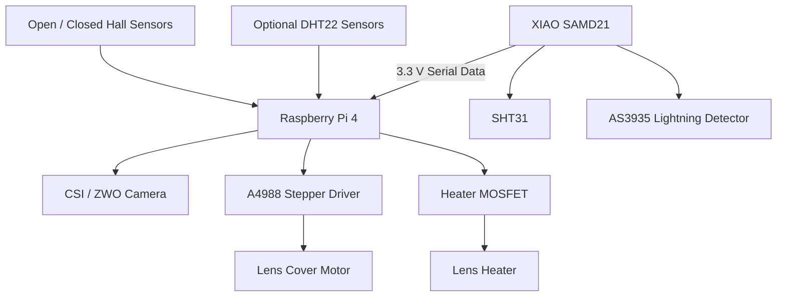

# 🔌 VIGILIS Meteor — Hardware & GPIO Guide

**Hardware integration, GPIO assignments, environmental sensors, motorized lens cover, and heater control for VIGILIS Meteor.**

[← Back to VIGILIS Meteor](README.md)

---

## 📖 Overview

VIGILIS Meteor is an open-source sky-monitoring platform designed for Raspberry Pi systems.

In addition to automated sky imaging, the application supports optional hardware for environmental monitoring, dew prevention, lightning detection, and motorized optical protection.

The reference hardware configuration combines:

- Raspberry Pi 4
- Raspberry Pi CSI or supported ZWO camera
- Seeed Studio XIAO SAMD21 outdoor controller
- SHT31 temperature and humidity sensor
- AS3935 lightning detector
- Optional DHT22 sensors
- A4988 stepper motor driver
- Motorized lens cover
- Two Hall position sensors
- MOSFET-controlled lens heater
- External motor and heater power supplies

Optional components can be disabled in the VIGILIS web interface when they are not installed.

### 📄 Wiring Diagrams

Detailed wiring diagrams are provided in a separate PDF document.

**[View / Download VIGILIS Meteor Wiring Diagrams](VIGILIS-Meteor-Wiring-Diagrams.pdf)**

The document includes:

1. Complete Wiring Overview
2. Outside Sensors
3. Inside Sensor
4. Stepper Motor Configuration

---

## ⚠️ Electrical Safety

**Incorrect wiring can permanently damage the Raspberry Pi, sensors, motor drivers, and connected hardware.**

Observe the following precautions:

- Raspberry Pi GPIO operates at 3.3 V logic.
- XIAO SAMD21 GPIO operates at 3.3 V logic.
- Never connect 5 V or 12 V directly to Raspberry Pi GPIO.
- Never connect a stepper motor directly to GPIO.
- Never power the lens heater directly from GPIO.
- Use appropriately rated external supplies for motors and heaters.
- Verify power supply polarity before connecting hardware.
- Use common signal grounds where required.
- Protect power circuits with appropriately rated fuses.
- Keep motor and heater wiring separated from sensitive signal wiring.
- Disconnect power before modifying hardware.
- Never disconnect a stepper motor while the motor driver is powered.
- Configure the stepper driver current limit before operation.
- Verify all component voltage and current ratings.

**Hardware should be tested individually before enabling unattended operation.**

---

## 🧩 System Architecture

The Raspberry Pi operates as the central controller for VIGILIS Meteor.

It manages camera acquisition, environmental data, lens cover movement, heater regulation, archive processing, and the web interface.

The XIAO SAMD21 operates as a dedicated outdoor sensor controller.

### Architecture Overview

### Hardware Responsibilities

| Component | Function |
|---|---|
| Raspberry Pi 4 | Main application and hardware controller |
| CSI / ZWO Camera | Sky image acquisition |
| XIAO SAMD21 | Outdoor environmental data collection |
| SHT31 | Temperature and humidity measurement |
| AS3935 | Lightning event detection |
| A4988 | Stepper motor control |
| Hall sensors | Lens cover position feedback |
| MOSFET | Lens heater power switching |

---

## 📌 Raspberry Pi GPIO Assignment

All GPIO numbers use the **BCM numbering scheme**.

Physical pin numbers refer to the Raspberry Pi 40-pin GPIO header.

| Component | Signal | BCM GPIO | Physical Pin |
|---|---|---|---|
| A4988 | STEP | GPIO 17 | 11 |
| A4988 | DIR | GPIO 27 | 13 |
| A4988 | ENABLE | GPIO 22 | 15 |
| Hall sensor | Cover open | GPIO 5 | 29 |
| Hall sensor | Cover closed | GPIO 6 | 31 |
| Heater MOSFET | Gate control | GPIO 24 | 18 |
| Indoor DHT22 | Data | GPIO 4 | 7 |
| Outdoor DHT22 | Data | GPIO 18 | 12 |
| XIAO SAMD21 | Serial input | GPIO 13 | 33 |

### GPIO Notes

- GPIO 17, 27, and 22 control the A4988.
- GPIO 5 and 6 provide lens cover position feedback.
- GPIO 24 controls the heater MOSFET.
- GPIO 13 receives serial data from the XIAO SAMD21.
- GPIO 4 and 18 are assigned to optional DHT22 sensors.

Verify that the configured GPIO assignments match the installed firmware and hardware.

Avoid assigning multiple functions to the same GPIO.

---

## 🔵 XIAO SAMD21 Outdoor Controller

The Seeed Studio XIAO SAMD21 provides a dedicated interface for external environmental sensors.

It collects data from the SHT31 and AS3935 and transmits measurements to the Raspberry Pi.

The outdoor controller uses a one-way serial connection.

### XIAO Pin Assignment

| XIAO Pin | Function | Connection |
|---|---|---|
| 3V3 | Power | Raspberry Pi 3.3 V |
| GND | Ground | Raspberry Pi GND |
| D4 | I²C SDA | SHT31 + AS3935 |
| D5 | I²C SCL | SHT31 + AS3935 |
| D2 | Interrupt input | AS3935 IRQ |
| D6 / TX | Serial output | Raspberry Pi GPIO 13 |

### Power Supply — Raspberry Pi 3.3 V

The reference VIGILIS Meteor installation powers the XIAO SAMD21 directly from the Raspberry Pi's regulated 3.3 V rail.

The XIAO is not supplied through an additional 5 V connection in this configuration.

| Raspberry Pi | XIAO SAMD21 |
|---|---|
| 3.3 V — Physical Pin 1 or 17 | 3V3 |
| GND | GND |
| GPIO 13 — Physical Pin 33 | D6 / TX |

The XIAO SAMD21, SHT31, and AS3935 share a 3.3 V logic environment.

**Important power considerations:**

- Do not connect an additional 5 V supply to this reference configuration.
- Verify the available current capacity of the Raspberry Pi 3.3 V rail.
- Ensure that all sensor modules support 3.3 V operation.
- Never apply 5 V signals to Raspberry Pi GPIO.
- Verify that powering the XIAO through its 3V3 pin is supported by the installed board revision and manufacturer documentation.

Direct 3V3 power injection may bypass onboard power regulation or protection circuitry. This wiring documents the existing installation and is not a general recommendation for every XIAO board.

### Serial Communication

The XIAO sends measurement data through its TX output.

| Raspberry Pi | XIAO SAMD21 |
|---|---|
| GPIO 13 — Physical Pin 33 | D6 / TX |
| GND | GND |

The serial connection uses 3.3 V logic levels.

Only one-way communication is required for the documented configuration.

Serial communication settings must match the installed XIAO firmware and Raspberry Pi application.

---

## 🌡️ Environmental Sensors

VIGILIS supports environmental measurements from different hardware configurations.

The reference hardware documentation includes optional DHT22 sensors connected directly to the Raspberry Pi and an SHT31 connected to the XIAO SAMD21.

### Option A — DHT22 Sensors

The DHT22 measures temperature and relative humidity.

#### Indoor DHT22

| DHT22 Pin | Raspberry Pi |
|---|---|
| VCC | 3.3 V |
| DATA | GPIO 4 — Physical Pin 7 |
| GND | GND |

#### Outdoor DHT22

| DHT22 Pin | Raspberry Pi |
|---|---|
| VCC | 3.3 V |
| DATA | GPIO 18 — Physical Pin 12 |
| GND | GND |

A 4.7–10 kΩ pull-up resistor between DATA and VCC is typically required unless integrated into the sensor module.

Keep signal wiring away from motors, switching power supplies, and heater power lines.

### Option B — SHT31 on XIAO SAMD21

The SHT31 provides temperature and relative humidity measurements through an I²C interface.

| SHT31 Pin | XIAO SAMD21 |
|---|---|
| VIN / VCC | 3V3 |
| GND | GND |
| SDA | D4 |
| SCL | D5 |

The standard I²C address is:

`0x44`

Some SHT31 modules also support:

`0x45`

The SHT31 shares the I²C bus with the AS3935.

Verify that each device has a unique address and that suitable I²C pull-up resistors are present.

---

## ⚡ AS3935 Lightning Detection

The AS3935 provides optional lightning-related electromagnetic event detection.

The sensor connects to the XIAO SAMD21 through I²C.

### AS3935 Connections

| AS3935 Pin | XIAO SAMD21 |
|---|---|
| VCC | 3V3 |
| GND | GND |
| SDA | D4 |
| SCL | D5 |
| IRQ | D2 |

### Supported Measurements

Depending on the configured hardware and firmware, the AS3935 can report:

- Lightning-related events
- Estimated lightning distance
- Noise conditions
- Disturber events

The IRQ output signals when sensor events require processing.

### Installation Recommendations

The AS3935 is sensitive to electromagnetic interference.

For improved reliability:

- Keep the sensor away from switching power supplies.
- Avoid placing it directly beside the Raspberry Pi.
- Maintain distance from stepper drivers and motor wiring.
- Avoid routing sensor connections alongside heater cables.
- Use short, carefully routed signal connections.
- Evaluate interference during heater and motor operation.

**Lightning detection is not a substitute for certified lightning protection or safety warning equipment.**

---

## ⚙️ Motorized Lens Cover

VIGILIS supports an optional motorized lens cover.

The reference implementation uses:

- Bipolar stepper motor
- A4988 stepper driver
- Two Hall position sensors
- External motor power supply

The Raspberry Pi controls motor movement and reads position feedback.

### A4988 Stepper Driver Connections

| A4988 Pin | Connection |
|---|---|
| VDD | Raspberry Pi 3.3 V |
| Logic GND | Common GND |
| STEP | GPIO 17 |
| DIR | GPIO 27 |
| ENABLE | GPIO 22 |
| RESET | Connected to SLEEP |
| SLEEP | RESET and VDD |
| MS1 / MS2 / MS3 | Microstepping configuration |
| VMOT | External motor supply positive |
| Motor GND | External motor supply negative |
| 1A / 1B | Stepper motor coil A |
| 2A / 2B | Stepper motor coil B |

### Motor Power Supply

The stepper motor requires an appropriately rated external power supply.

Do not power the motor directly from the Raspberry Pi.

The motor supply must remain within the electrical limits of the driver and stepper motor.

Install a suitable electrolytic capacitor near VMOT and motor GND.

The reference hardware documentation recommends a capacitor in the 47–100 µF range or greater, with an adequate voltage rating.

Follow the motor driver manufacturer's recommendations for the final capacitor selection.

### A4988 Current Limit

Configure the motor driver current limit before operating the stepper motor.

The correct setting depends on:

- Motor rated phase current
- Driver current-sense resistor values
- Driver board design
- Available cooling
- Operating conditions

Do not assume that the motor power supply's rated current is the correct driver current-limit setting.

### Motor Coil Identification

A bipolar stepper motor contains two separate windings.

Use a multimeter to identify the coil pairs.

- Connect coil A to 1A and 1B.
- Connect coil B to 2A and 2B.
- Reverse one coil's wiring if the motor direction must be changed.

Stepper motor wire colors are not standardized.

**Never connect or disconnect stepper motor wiring while the driver is powered.**

### Microstepping

The A4988 supports multiple microstepping configurations.

The MS1, MS2, and MS3 inputs determine the microstepping mode.

Ensure the selected configuration matches the mechanical setup and VIGILIS movement parameters.

---

## 🧲 Hall Position Sensors

Two Hall sensors monitor the lens cover position.

They provide feedback for the fully open and fully closed positions.

### Hall Sensor Assignment

| Sensor | Supply | Ground | Signal |
|---|---|---|---|
| Cover Open | 3.3 V | Common GND | GPIO 5 |
| Cover Closed | 3.3 V | Common GND | GPIO 6 |

The documented VIGILIS configuration uses active-low Hall inputs with pull-ups.

### Position Feedback

- Open sensor detects the fully open position.
- Closed sensor detects the fully closed position.

This allows VIGILIS to determine the mechanical state of the lens cover.

### Installation Notes

- Verify the sensor output type.
- Ensure the sensor output does not exceed 3.3 V.
- Configure the required pull-up resistors.
- Check magnetic alignment before automatic operation.
- Keep moving components clear of cables and obstructions.
- Test both position sensors individually.

The mechanical design should prevent damage if a sensor or movement command fails.

---

## 🔥 Lens Heater Control

VIGILIS supports an optional electrically controlled lens heater.

The reference implementation uses a logic-level N-channel MOSFET as a low-side switch.

### MOSFET Connections

| Connection | Destination |
|---|---|
| Raspberry Pi GPIO 24 | MOSFET gate through 100–220 Ω resistor |
| MOSFET gate | 10 kΩ pull-down to GND |
| MOSFET source | Common GND |
| MOSFET drain | Heater negative |
| Heater positive | External supply positive |
| External supply negative | Common GND |

### MOSFET Selection

Use a logic-level N-channel MOSFET suitable for 3.3 V gate drive.

Verify:

- Heater supply voltage
- Maximum heater current
- MOSFET drain-source voltage rating
- On-state resistance at the intended gate voltage
- Thermal dissipation
- Connector and cable ratings
- Fuse rating

A MOSFET marketed as "logic level" is not automatically guaranteed to switch efficiently at 3.3 V.

Check the manufacturer's datasheet.

### Heater Regulation

VIGILIS supports dew-point-based heater regulation.

Environmental measurements can be used to adjust heater operation and reduce condensation on optical surfaces.

Actual regulation depends on the installed sensors and application configuration.

### Electrical Protection

Use an appropriately rated external heater supply.

Install suitable overcurrent protection and ensure all components remain within their electrical and thermal operating limits.

---

## 🔋 Power Distribution

The VIGILIS hardware architecture separates low-voltage logic from higher-current electrical loads.

### Logic Power

Supplies:

- Raspberry Pi GPIO interfaces
- XIAO SAMD21
- Environmental sensors
- Lightning detector
- Compatible logic circuits

The reference installation supplies the XIAO SAMD21 from the Raspberry Pi 3.3 V rail.

### Motor Power

The motor power supply feeds the A4988 motor supply input.

Motor current must not flow through Raspberry Pi GPIO connections.

### Heater Power

The external heater supply provides power to the heater through its switching circuit.

### Grounding

Compatible signal interfaces require a common voltage reference.

Plan ground connections to avoid excessive voltage drop, interference, and unintended current paths.

Avoid routing motor and heater return currents through sensitive signal ground wiring.

### Recommended Checks

- Correct supply polarity
- Appropriate supply voltage
- Sufficient current capacity
- Appropriate fuse protection
- Proper wire gauge
- Secure connectors
- Outdoor moisture protection
- Cable strain relief

---

## 🧰 Installation & Configuration

After connecting the hardware, configure the installed components through the VIGILIS web interface.

### Environmental Sensors

Select the appropriate sensor configuration for the installed hardware.

### Lens Cover

Configure motor movement and position detection according to the installed mechanical system.

### Heater

Enable and configure heater regulation according to the available sensors and heater hardware.

### Optional Components

Disable unused hardware features when their corresponding components are not installed.

Test each hardware function individually before enabling automatic operation.

---

## 🔍 Hardware Troubleshooting

### Environmental Sensor Not Detected

Check:

- Supply voltage
- Ground connections
- GPIO assignment
- Sensor configuration
- Pull-up resistors
- I²C wiring and addresses

### XIAO SAMD21 Data Not Received

Check:

- Raspberry Pi 3.3 V supply
- XIAO 3V3 connection
- Common ground
- XIAO D6 / TX output
- Raspberry Pi GPIO 13
- Firmware compatibility
- Serial communication settings

### AS3935 Reports Excessive Noise

Check:

- Distance from switching power supplies
- Stepper motor interference
- Heater switching noise
- Sensor placement
- I²C wiring
- Outdoor electromagnetic conditions

### Stepper Motor Does Not Move

Check:

- External motor supply
- A4988 power connections
- Motor winding connections
- Current limit
- STEP, DIR, and ENABLE pins
- RESET and SLEEP connections
- Microstepping configuration

### Lens Cover Position Not Detected

Check:

- Hall sensor supply voltage
- Open and closed GPIO connections
- Active-low configuration
- Pull-up resistors
- Magnetic alignment
- Sensor output voltage

### Heater Does Not Activate

Check:

- External heater supply
- GPIO 24 configuration
- MOSFET pinout
- Gate-drive compatibility
- Heater wiring
- Fuses
- Heater settings

---

## ✅ Pre-Power Checklist

Complete the following checks before applying power to the assembled hardware.

- [ ] BCM GPIO assignments verified
- [ ] Raspberry Pi logic voltage verified
- [ ] XIAO 3V3 supply configuration verified
- [ ] XIAO board power-input compatibility checked
- [ ] Sensor wiring verified
- [ ] Common signal ground correctly implemented
- [ ] I²C wiring and pull-ups verified
- [ ] Hall sensor output voltage verified
- [ ] Stepper motor winding pairs identified
- [ ] A4988 current limit configured
- [ ] Motor supply capacitor installed correctly
- [ ] Stepper motor connected before driver power-up
- [ ] Heater MOSFET pinout verified
- [ ] External supply polarity verified
- [ ] Supply voltage and current ratings checked
- [ ] Appropriate fuses installed
- [ ] No exposed conductors or short circuits
- [ ] Moving components mechanically unobstructed

**Do not enable unattended operation until the individual hardware functions have been tested successfully.**

---

## 📚 Technical References

Official manufacturer documentation:

- [Raspberry Pi Documentation](https://www.raspberrypi.com/documentation/)
- [Seeed Studio XIAO SAMD21](https://wiki.seeedstudio.com/Seeeduino-XIAO/)
- [Sensirion SHT31](https://sensirion.com/)
- [ScioSense AS3935](https://www.sciosense.com/)
- [Allegro A4988](https://www.allegromicro.com/)

For detailed wiring information:

**[VIGILIS Meteor Wiring Diagrams (PDF)](VIGILIS-Meteor-Wiring-Diagrams.pdf)**

---

## 🤝 Project & Support

VIGILIS Meteor is an open-source Raspberry Pi sky-monitoring project.

Hardware feedback, installation experiences, and issue reports are welcome.

[GitHub Repository](https://github.com/1alex-vag/Vigilis-Meteor)

[Report a Hardware Issue](https://github.com/1alex-vag/Vigilis-Meteor/issues)

---

## 👨‍💻 Credits

Developed by **Alexander Gschöpf**

Astrophotography & Astronomy:

**[@ag_astrophotography](https://www.instagram.com/ag_astrophotography/)**

---

## 📄 License

This documentation is distributed under the project's MIT License.

See [LICENSE](LICENSE) for details.

---

  <strong>VIGILIS Meteor</strong> 
  Hardware Integration & GPIO Documentation  
  Developed by
  <a href="https://www.instagram.com/ag_astrophotography/">ag_astrophotography</a>

[← Back to README](README.md)
